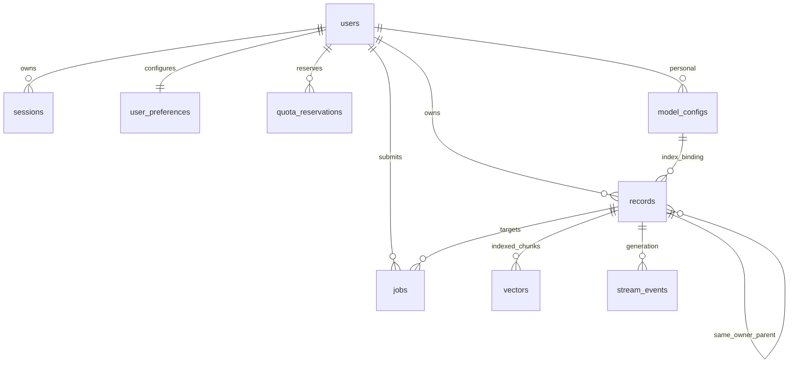

# V2 数据与权限设计

本设计使用现有 React 页面、解析器和模型协议实现，新增 PostgreSQL 数据层和认证入口。旧入口 `app.main:application` 保留；新入口 `app.multiuser.main:application` 使用独立配置。两个入口不可挂载同一个数据目录。

## 接口权限矩阵

旧版共 53 个路由（main 8、documents 13、indexes 4、chat 11、models 8、data 3、backups 6），逐项清单见 `V1_ROUTES.json`。它们在单机入口仍受本机限制；V2 入口不挂载这些无需认证的旧 router。

| 路由组 | 未登录 | 普通用户 | 管理员 | 数据约束 |
| --- | --- | --- | --- | --- |
| health、登录 | 最小状态、受限登录 | 同左 | 同左 | 不含容量、路径或凭据 |
| auth/me、password、logout | 401 | 本人 | 本人 | 强制改密时只允许账号操作 |
| dashboard、settings、data | 401 | 本人 | 本人 | 只统计当前用户 |
| knowledge-bases、documents、versions、chunks | 401 | 本人 | 本人 | 列表和 ID 操作都限定 owner |
| indexes、retrieval、jobs | 401 | 本人 | 本人 | owner、目标、有效版本和指纹先过滤 |
| conversations、messages、generations、sources、events | 401 | 本人 | 本人 | 来源快照和每次 SSE 轮询校验会话 |
| model-configs | 401 | 本人 API 和公开平台能力 | 本人 API 和公开平台能力 | 平台公开字段白名单 |
| exports | 401 | 本人 | 本人 | 校验归属后读取文件 |
| admin/users、models、quotas、status | 401 | 403 | 运营 | 不返回私有正文或密钥 |
| 全站备份/恢复 CLI | 不提供公开接口 | 无 | 运维环境授权执行 | 维护屏障、预检、回滚 |

所有修改使用 CSRF；跨账号 ID 统一 404，批量范围中有无权 ID 整体拒绝。普通用户不能访问旧整库恢复和 Ollama 下载接口。

## 数据关联

关联字段不能只存在 JSON。records、jobs、vectors、stream_events 使用 `(owner_id, id)` 复合外键，使跨用户关联无法写入。模型有显式 platform/personal scope；平台模型不采用普通资料空 owner 的通用规则。配置版本不可变；启停属于生命周期元数据。个人偏好改变不修改已有知识库绑定。

## 关键流程

1. 会话哈希查询得到用户，校验启停、改密、过期和 CSRF。
2. 上传先授权目标知识库、检查限额、写私有暂存文件；数据库事务绑定用户、版本和任务。事务失败补偿文件。
3. worker 原子领取用户任务，带租约和配置快照；外部调用前后检查状态，陈旧租约禁止提交。
4. 检索先验证资料范围及兼容空间，SQL 仅加载该用户有效索引，分批计算相似度；来源成为独立历史快照。
5. 导出仅遍历本人记录，排除凭据和模型 secret；管理员恢复在全站维护屏障下进行。

## 风险及控制

数据库复合外键防止关系串用户；接口逐路由负面测试补充读权限。文件解析进入有界子进程；不信任文件名或 ZIP 路径。自带 API 的实际连接必须固定到经过公网校验的 IP，并保持 TLS SNI/证书校验；关闭环境代理和重定向。外部调用超时记为结果未知，不自动重试生成。备份屏障通过 PostgreSQL 共享/独占锁跨进程生效。真实 API/公网验收必须与协议模拟分开记录。

回滚：停止 V2 项目服务，继续运行基线提交 220924f 的 V1 入口和原目录；不要把 V2 PostgreSQL 恢复到 SQLite 目录。`.runtime/v1-baseline` 是私有一致性快照，不提交。
